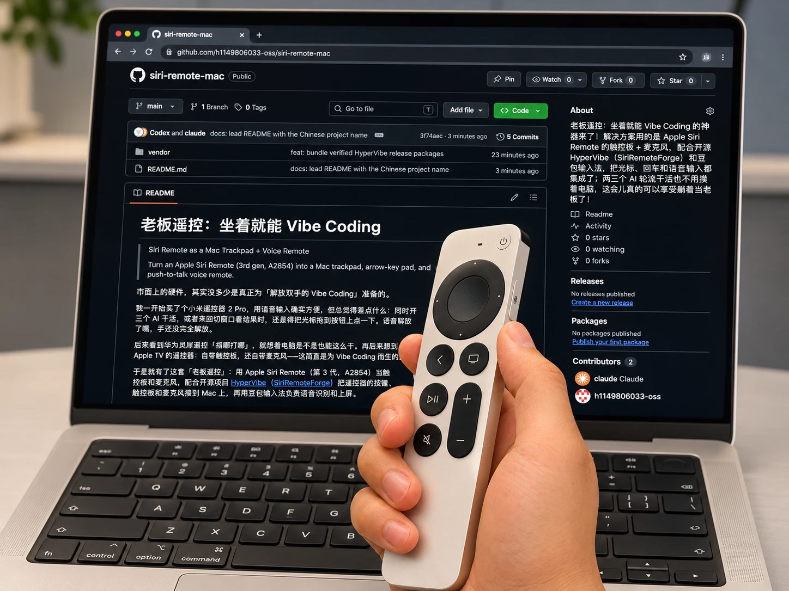
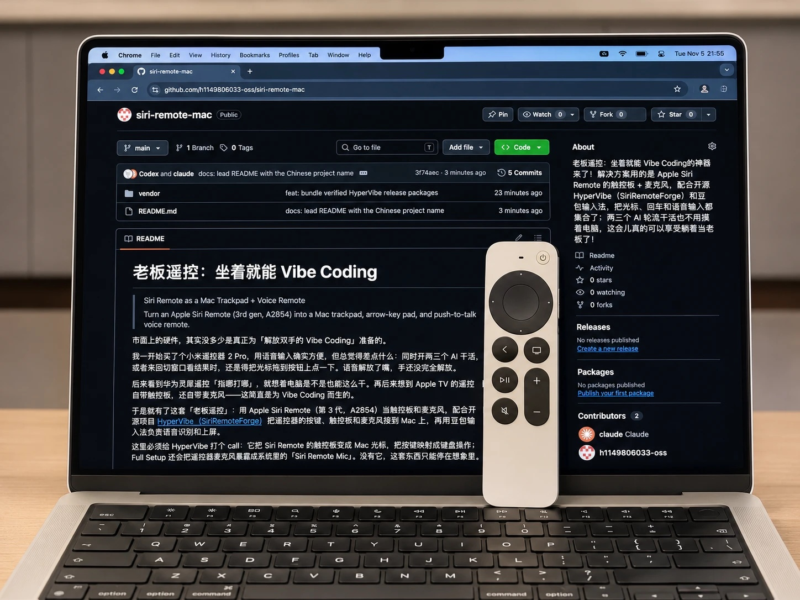
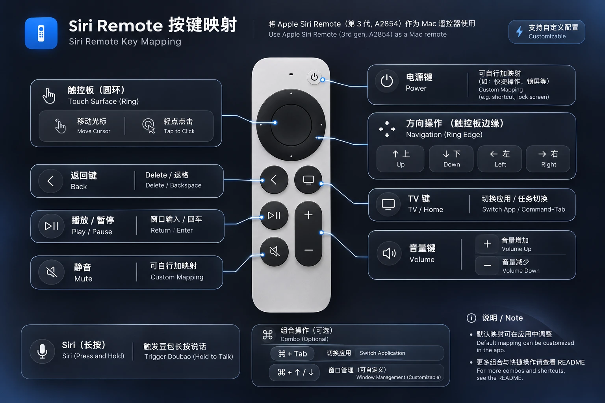

# 老板遥控boss-remote：坐着就能 Vibe Coding

> Siri Remote as a Mac Trackpad + Voice Remote
>
> Turn an Apple Siri Remote (3rd gen, A2854) into a Mac trackpad, arrow-key pad, and push-to-talk voice remote.
>
> [English introduction ↓](#english)

<p align="center">
  
  
</p>

市面上的硬件，其实没多少是真正为「解放双手的 Vibe Coding」准备的。

我一开始买了个小米遥控器 2 Pro，折腾的是开源项目 [无线麦 SayAll（HD838A/remote-mic-app）](https://github.com/HD838A/remote-mic-app)——它把小米蓝牙遥控器 2 / 2 Pro 变成 Mac 的无线麦克风，按住语音键就能往任意输入框里说话。用起来确实方便，但总觉得差点什么：同时开两三个 AI 干活，或者来回切窗口看结果时，还是得把光标拖到按钮上点一下。语音解放了嘴，手还没完全解放。

这套 Siri Remote 方案，最早就是在 SayAll 上折腾小米遥控器时得到的灵感——沿着「遥控器也可以当 Mac 输入设备」这条线继续往下走。没有它，我大概不会想到把遥控器接到 Mac 上。

后来看到华为灵犀遥控「指哪打哪」，就想着电脑是不是也能这么干。再后来想到 Apple TV 的遥控器：自带触控板，还自带麦克风——这简直是为 Vibe Coding 而生的。

于是就有了这套「老板遥控」：用 Apple Siri Remote（第 3 代，A2854）当触控板和麦克风，配合开源项目 [HyperVibe（SiriRemoteForge）](https://github.com/HOLODATA-COM/SiriRemoteForge) 把遥控器的按键、触控板和麦克风接到 Mac 上，再用豆包输入法负责语音识别和上屏。

这里必须给 HyperVibe 打个 call：它把 Siri Remote 的触控板变成 Mac 光标、把按键映射成键盘操作；Full Setup 还会把遥控器麦克风暴露成系统里的「Siri Remote Mic」。没有它，这套东西只能停在想象里。

语音输入天生比打字快，尤其是描述一个刚冒出来的想法时——想法转瞬即逝，说出来比敲出来更接近原样。豆包的语音识别会自动分点、罗列、重新组织，标点也处理得很顺，基本不用再修。

现在的状态是：坐着，拇指动一动就能移动光标、点按、切应用、删字、发消息；要说话就按住 Siri 键，松开文字就上屏。两三个 AI 轮流干活，也不用离开椅子去摸键盘鼠标。

这大概就是我想要的 Vibe Coding：人坐着，想法流动，手不用忙。

## English

**Boss Remote: Vibe Coding from the couch**

Most hardware out there isn't really built for hands-free Vibe Coding.

I started with a Xiaomi Remote 2 Pro and an open-source project called [SayAll (HD838A/remote-mic-app)](https://github.com/HD838A/remote-mic-app). It turns the Xiaomi Bluetooth remote into a wireless Mac microphone: hold the voice button, talk, and the text lands in whatever field has focus. That was genuinely useful, but something was still missing. When I had two or three AIs running and kept switching windows to check results, I still had to drag the cursor to a button and click. Voice freed my mouth; my hands were still busy.

This Siri Remote setup grew out of that experiment. SayAll was the moment I realized a remote could be a Mac input device; everything here follows that thread.

Then I saw Huawei's Lingxi remote and its "point anywhere" air-mouse idea, and wondered whether a computer could work the same way. Later I thought of the Apple TV remote: it already has a trackpad and a microphone. It felt like it was made for Vibe Coding.

So this is "Boss Remote": an Apple Siri Remote (3rd gen, A2854) as the trackpad and microphone, [HyperVibe (SiriRemoteForge)](https://github.com/HOLODATA-COM/SiriRemoteForge) to connect the remote's buttons, touch surface, and mic to the Mac, and the Doubao IME (a Chinese input method with strong speech recognition) for speech recognition and text insertion.

A shout-out to HyperVibe: it turns the Siri Remote's touch surface into a Mac cursor and maps its buttons to keyboard actions. Its `Full Setup` also exposes the remote microphone as a system input device called `Siri Remote Mic`. Without it, this would have stayed an idea.

Speaking is simply faster than typing, especially when you're trying to capture a thought before it disappears. Doubao's speech recognition also structures the result for you: it adds bullet points, reorganizes sentences, and handles punctuation well enough that I rarely have to clean it up.

The current workflow: I sit down, move the cursor with my thumb, click, switch apps, delete text, and send messages. When I want to talk, I hold the Siri button and release it when I'm done. Two or three AIs can take turns without me reaching for the keyboard or mouse.

That's the Vibe Coding I wanted: a human sitting down, ideas flowing, hands free.

The step-by-step setup guide below is currently in Chinese; this English section is here so English readers can see what the project is about.

---

## 本仓库内容

| 路径 | 内容 |
|---|---|
| `README.md` | 单文件文档：完整配置、按键、安装、踩坑与排查 |
| `assets/` | README 里的实拍配图和按键映射图 |
| `vendor/HyperVibe-0.2.0-beta.9-macOS-arm64.zip` | 上游官方 App-only 包，约 4.2 MB |
| `vendor/HyperVibe-Full-Setup-0.2.0-beta.9-arm64.pkg` | 上游官方 Full Setup 包，约 4.7 MB，含麦克风驱动与守护进程 |
| `vendor/SHA256SUMS.txt` | 上述两个包的 SHA256 |

两个二进制包都是上游官方 Release 的原样转载，未做修改。校验方法见「安装 HyperVibe + Full Setup」。HyperVibe 以 GPLv3 发布，许可证随包附带；源码与新版见[上游 Release](https://github.com/HOLODATA-COM/SiriRemoteForge/releases/tag/v0.2.0-beta.9)。

---

## 实测环境

| 项目 | 版本 / 型号 |
|---|---|
| Mac | Apple Silicon，macOS 27.0.1 |
| 遥控器 | Apple Siri Remote 3rd gen（A2854，USB-C） |
| 蓝牙 ID | Vendor `0x004C` / Product `0x0315` |
| HyperVibe | 0.2.0-beta.9（SiriRemoteForge） |
| 麦克风桥接 | HyperVibe Full Setup，`Siri Remote Mic`，1 ch / 48 kHz |
| 语音识别 | 豆包输入法（Doubao IME） |
| 实测日期 | 2026-11 |

> 这是个人实践记录，不是 Apple、HyperVibe 或豆包的官方文档。HyperVibe 仍是 beta；macOS 大版本升级后可能失效，升级前建议先备份配置。

---

## 平台支持

- **macOS**：本方案完整验证。Apple Silicon + macOS 27.0.1；Siri Remote 作为标准蓝牙 HID 设备连接，HyperVibe 处理触控板和按键，Full Setup 暴露麦克风。macOS 上这套链路是原生适配的。
- **Windows**：尚未验证。蓝牙 HID 和麦克风大概率能工作，但触控板/手势需要单独做驱动或映射（HyperVibe 是 macOS 应用）。等跑通后会补充说明。

macOS is fully tested. Windows is untested: Bluetooth HID and the microphone should mostly work, but the touch surface will need separate mapping. I'll update this once it's verified.

---

## 能做什么

- 触控板移动光标，轻点点击，按住中心键 0.5 秒开始拖拽。
- 圆环上下左右当方向键。
- Back 键当 Delete（退格），输入文字时直接删字。
- Play/Pause 键当 Return（回车），聊天窗口打完字按一下直接发送。
- TV 键当 Command-Tab，切换应用。
- 按住 Siri 键说话，豆包输入法把语音变成文字并上屏。
- 光标速度、加速度、滚动方向、长按阈值都可以调。

---

## 为什么选这套

| 方案 | 触控板/指针 | 麦克风 | Mac 独立可用 | 备注 |
|---|---|---|---|---|
| **Siri Remote 3rd gen + HyperVibe** | 有 | 有 | 是 | 本方案；一个遥控器搞定两件事 |
| 小米遥控器 RC003 + SayAll | 无 | 有 | 是 | 只能语音，不能当鼠标 |
| 华为灵犀遥控 | UWB 绝对指向 | 有 | 否 | 依赖电视侧 SmartBar 锚点，Mac 单独用不了 |
| LG Magic Remote | 有 | 有 | 基本否 | 主要面向 LG 电视，Mac 驱动不成熟 |
| 索尼电视遥控 | 无/有限 | 部分 | 否 | 缺少 Mac 触控板支持 |

Siri Remote 的优势是：**触控板 + 麦克风在同一只遥控器上**，而且 HyperVibe 已经处理了 HID 触摸、按键映射和光标加速。

---

## 工作原理

```text
┌─────────────────────────────────────┐
│ Apple Siri Remote (A2854)           │
│  ├─ 触控板 / 按键  → BLE HID        │
│  └─ 麦克风         → ATVV 音频      │
└───────────────┬─────────────────────┘
                │ Bluetooth
        ┌───────┴────────┐
        │                │
┌───────▼────────┐  ┌────▼──────────────────────────┐
│ HyperVibe      │  │ SiriRemoteMic（Full Setup）    │
│ HID → 光标/键盘 │  │ ATVV → CoreAudio HAL 驱动      │
└───────┬────────┘  └────┬──────────────────────────┘
        │                │
        ▼                ▼
  macOS 光标/键盘    「Siri Remote Mic」虚拟输入设备
                         │
                         ▼
                   豆包输入法（按住右 Command）
                         │
                         ▼
                      文字上屏
```

关键点：HyperVibe 负责「触控和按键」，Siri Remote Mic 负责「麦克风音频」，豆包负责「语音识别」。三者解耦，任何一环都可以替换。

---

## 准备工作

### 硬件

- Apple Siri Remote 第 3 代（A2854，USB-C，主包用的是这个，建议直接买这个就好了，二手的咸鱼大概两百多，拆机全新的三百多）。
  - 第 2 代（A2540）理论相似，但本方案只在 A2854 上验证过。
- Apple Silicon Mac，macOS 13 或更高（本方案在 macOS 27.0.1 验证）。
- 遥控器先充电。电量低时它可能完全不响应，看起来像坏了。

### 软件

- [HyperVibe / SiriRemoteForge](https://github.com/HOLODATA-COM/SiriRemoteForge) 的 **Full Setup** 安装包。
  - 本仓库 `vendor/` 已附带官方 `HyperVibe-Full-Setup-0.2.0-beta.9-arm64.pkg`；也可以从上游 Releases 下载最新版。
  - 不要只装 App；Full Setup 才会安装麦克风驱动和采集守护进程。只想先试触控板时，可以用 `vendor/HyperVibe-0.2.0-beta.9-macOS-arm64.zip`（App-only，没有麦克风驱动）。
- Apple **PacketLogger**（来自 Apple Developer 的 Additional Tools for Xcode）。
  - Full Setup 的麦克风链路需要它；如果安装器提示缺失，把 `PacketLogger.app` 放到 `/Applications`。
- 豆包输入法：[官方下载](https://shurufa.doubao.com/pc)。本仓库不附带安装包，避免闭源软件再分发和版本过期。
- 可选：Apple TV 先断电，避免它把遥控器抢回去。Siri Remote 同一时间只连一个设备。

---

## 快速开始

### 1. 配对遥控器

1. 给遥控器充电，靠近 Mac。
2. 关闭或拔掉 Apple TV 电源，避免遥控器自动连回电视。
3. Mac：**系统设置 → 蓝牙**。
4. 按住遥控器 **Back（‹）+ 音量 +** 约 5 秒，直到「附近设备」出现遥控器。
5. 点击连接。
6. 可选验证：

```bash
system_profiler SPBluetoothDataType | grep -i -A 8 'siri'
```

应能看到 Vendor ID `0x004C`、Product ID `0x0315`。

配对不上时：

- 按住 **TV + 音量 -** 约 5 秒重启遥控器，再重试。
- 让遥控器离 Mac 近一点。
- 确认 Apple TV 已断电，且没有另一台 Mac 连着它。

> Siri Remote 同一时间只连一个设备。用它控制 Mac 时，Apple TV 需要断开；要回去控制 Apple TV 时再重新配对。

### 2. 安装 HyperVibe + Full Setup

1. 安装 **Full Setup** PKG（推荐）：
   - 本仓库：`vendor/HyperVibe-Full-Setup-0.2.0-beta.9-arm64.pkg`；
   - 或上游 Releases 的最新 Full Setup。
   - PKG 未签名，安装时用 **Control-click → 打开**。
   - 只想先试触控板：解压 `vendor/HyperVibe-0.2.0-beta.9-macOS-arm64.zip`，把 `HyperVibe.app` 拖到 `/Applications`；这个包没有 `Siri Remote Mic`。
2. 安装前建议校验：

   ```bash
   cd vendor
   shasum -a 256 -c SHA256SUMS.txt
   ```

   应输出两个 `OK`。`vendor/` 里的文件是上游官方发布包的原样转载；许可证在 App 包内，源码见上游 `v0.2.0-beta.9`。
3. 如果安装器提示缺少 PacketLogger：
   - 安装 Apple Developer 的 **Additional Tools for Xcode**；
   - 把 `PacketLogger.app` 拷到 `/Applications`。
4. 安装完成后打开 HyperVibe。
5. 按向导授予权限：
   - **蓝牙**：连接遥控器。
   - **输入监控（Input Monitoring）**：读取遥控器按键。
   - **辅助功能（Accessibility）**：发送光标/键盘事件、窗口控制。
   - 如果使用 HyperVibe 自带转写，再授予**麦克风**；本方案用豆包识别，麦克风主要给豆包。
6. 如果 HyperVibe 没有出现在权限列表里，点 `+` 手动添加 `/Applications/HyperVibe.app`。

> HyperVibe 的公开版本是 ad-hoc 签名，不是 Apple 公证版本。更新、重装或自行重编译后，macOS 可能把辅助功能/输入监控授权重置，需要重新添加。

### 3. 配置 HyperVibe

配置文件：

```text
~/.config/siriremote/config.jsonc
```

HyperVibe 会监听这个文件并热加载；保存后不需要重启。

下面是本机已验证的完整配置，可以整份替换 `~/.config/siriremote/config.jsonc`；也可以只合并 `modes` / `settings` 里的相关项，缺失项会用默认值：

```jsonc
{
  "appProfiles": {
    "default": "global"
  },
  "modes": {
    "L1": { "inherits": "global" },
    "L2": { "inherits": "global" },
    "global": {
      // 按住 Siri 键 = 按住右侧 Command，交给豆包「长按说话」。
      // 不要用 pushToTalk：它只会点按修饰键约 30ms，豆包收不到长按。
      "button.siri": {
        "action": "repeatKey",
        "keys": "rcmd",
        "delay": 60,
        "interval": 60
      },
      "ring.up": { "action": "keystroke", "keys": "up" },
      "ring.down": { "action": "keystroke", "keys": "down" },
      "ring.left": { "action": "keystroke", "keys": "left" },
      "ring.right": { "action": "keystroke", "keys": "right" },
      "button.menu": { "action": "keystroke", "keys": "delete" },
      "button.tv": { "action": "keystroke", "keys": "cmd+tab" },
      // 中间确认键（select）在 HyperVibe 里写死为鼠标点击，配置无效。
      // 用播放/暂停键发送回车；.hold 防止长按连发多个回车。
      "button.playPause": { "action": "keystroke", "keys": "return" },
      "button.playPause.hold": { "action": "keystroke", "keys": "return" }
    }
  },
  "settings": {
    "cursorSpeed": 0.6,
    "statusWidgetEnabled": false,
    "layerHUDEnabled": true,
    "holdHUDEnabled": true,
    "launchAtLoginEnabled": false,
    "dictation": {
      "activeMode": "external",
      "enabled": false,
      "pipelineOverlayEnabled": false
    }
  }
}
```

各项说明：

| 配置 | 作用 |
|---|---|
| `button.siri` → `repeatKey` + `rcmd` | 按住 Siri 键时真正按住右 Command，豆包的长按说话才能触发。 |
| `button.menu` → `delete` | Back 键当退格，输入文字时直接删字。 |
| `button.tv` → `cmd+tab` | TV 键切换应用。 |
| `button.playPause` → `return` | 播放/暂停键当回车，聊天窗口里发送消息。 |
| `button.playPause.hold` → `return` | 长按时只发一次回车，避免连发。 |
| `dictation.activeMode: external` | 不让 HyperVibe 自己转写，交给豆包。 |
| `dictation.enabled: false` | 关闭 HyperVibe 自带语音链路，避免和豆包抢麦克风。 |
| `dictation.pipelineOverlayEnabled: false` | 关闭 HyperVibe 的语音浮层。 |
| `statusWidgetEnabled: false` | 关闭右上角常驻状态窗（就是显示 `VOICE / PITCH / BRIGHT` 的那个）。 |
| `layerHUDEnabled` | 遥控器连接/断开时是否弹卡片；嫌烦可以改 `false`。 |
| `holdHUDEnabled` | 长按进度卡片；不需要可以改 `false`。 |
| `cursorSpeed` | 光标速度，`0.6` 是中等；觉得慢就调大。 |

> `button.select` 即使写了也不会生效，原因见下面的「中间确认键」。

### 4. 配置豆包输入法

1. 从[豆包输入法官方下载页](https://shurufa.doubao.com/pc)安装，并在 **系统设置 → 键盘 → 输入法** 中添加。
2. 打开豆包输入法的语音设置：
   - **快捷键**：按住**右侧 Command（右⌘）**。
   - **模式**：长按说话 / 按住说话（不要选点击说话）。
   - **麦克风**：`Siri Remote Mic`。
3. 在 TextEdit 或聊天窗口里测试：
   - 按住遥控器 Siri 键；
   - 说话；
   - 松开；
   - 文字应出现在输入框里。

如果豆包的界面文字和上面不完全一致，按「语音输入 → 快捷键 / 麦克风」找对应项即可。

> **两个最容易踩的坑：**
>
> - **麦克风一定要选 `Siri Remote Mic`**。选 Mac 内置麦克风，遥控器的声音进不来，豆包可能完全没反应。
> - **长按快捷键必须和 HyperVibe 对齐**。默认两边都是右侧 Command（右⌘）：HyperVibe 的 `button.siri` 是 `repeatKey` + `keys: "rcmd"`，豆包这边是「长按模式 → 右⌘」。只改一边，会出现“有语音 HUD、但不出字”。

### 5. 验证

HyperVibe 调试日志：

```bash
tail -f /tmp/hypervibe.log
```

按遥控器按键时，应看到类似：

```text
HID event: ... → select
HID event: ... → playPause
action: keystroke(keys: "return")
action: keystroke(keys: "delete")
```

麦克风链路日志：

```bash
sudo tail -f /var/log/srm_captured.log
```

按住 Siri 键说话时，应看到类似：

```text
srm_router: voice stream 0x004A/ATT-0x0035
```

音频设备检查：

- 打开 **音频 MIDI 设置**；
- 应能看到 **Siri Remote Mic**，1 个输入通道，48 kHz。

验收清单：

- [ ] 遥控器出现在蓝牙里，HyperVibe 显示已连接。
- [ ] 手指在触控板上移动，光标跟着动。
- [ ] 圆环上下左右能发方向键。
- [ ] Back 键能删字。
- [ ] Play/Pause 键能发送回车。
- [ ] 按住 Siri 键说话，豆包能出字。
- [ ] `Siri Remote Mic` 出现在音频输入设备里。

---

## 按键映射

下面这张图是完整按键映射（中文 + English）：



| 操作 | 实际发送 | 说明 |
|---|---|---|
| 触控板移动 | 光标移动 | 支持加速度和轻点点击 |
| 轻点触控板 | 鼠标左键 | HyperVibe 的 tap-to-click |
| 中心键轻按 | 鼠标左键 | 当前 HyperVibe 写死为点击，配置改不了 |
| 中心键按住 0.5 秒 | 拖拽 | 松开结束拖拽；不想要拖拽可以忽略 |
| 圆环 ↑↓←→ | 方向键 | 可改成翻页、切 tab 等 |
| Back ‹ | Delete / 退格 | 输入文字时删字 |
| TV | Command-Tab | 切换应用 |
| Play/Pause ⏯ | Return / 回车 | 聊天窗口发送 |
| Siri（按住） | 右侧 Command | 触发豆包长按说话 |
| 音量 + / - | 系统音量 | HyperVibe 配置未自定义；按键本身可调音量 |
| 电源 | 未绑定 | 绑定前先看 HyperVibe README 的系统设置说明 |
| 静音 | 未绑定 | 可自行加映射 |

---

## 关键细节与踩坑

### 1. 为什么 Siri 键必须用 `repeatKey`，不能用 `pushToTalk`

HyperVibe 的 `pushToTalk` 在按下和松开时各调用一次 `Keys.synthesize`。对于「只有修饰键」的组合（例如右 Command），它实际做的是一个约 30ms 的按下/松开点按。

豆包的语音快捷键是**长按模式**，它等待的是「右 Command 持续按住」。30ms 的点按会被当成普通按键，录音不会启动，所以你只会看到 HUD，不出字。

`repeatKey` 的行为不同：按下时调用 `holdBegin`，松开时调用 `holdEnd`，中间一直保持右 Command 按下。配置里的 `delay` / `interval` 只是重复节奏，不影响「按住」这个事实。

```jsonc
"button.siri": {
  "action": "repeatKey",
  "keys": "rcmd",
  "delay": 60,
  "interval": 60
}
```

这就是整套方案最关键的一处。

### 2. 中间确认键不能改成回车

HyperVibe 当前版本把 `select`（中心点击）写死为触控板点击：

- 轻点 → 鼠标左键；
- 按住 0.5 秒 → 拖拽；
- 配置里的 `button.select` **不会被执行**。

因此本方案把 **Play/Pause 键**映射成 Return 作为发送键，并加 `button.playPause.hold` 防止长按连发。

如果你非要让中心键发回车，只能修改 HyperVibe 源码并重新编译（GPLv3 开源）。代价是：

- 重新编译会改变 ad-hoc 签名，辅助功能/输入监控/蓝牙授权可能被重置；
- 应用更新可能覆盖你的修改；
- 需要自己维护一个 fork。

日常使用建议直接用 Play/Pause 键，成本最低。

### 3. 右上角 `VOICE / PITCH / BRIGHT` 小窗

那不是豆包，是 HyperVibe 的常驻状态窗（Status Widget）。它会在语音时显示音高、亮度电平等信息。

不想看到它：

```jsonc
"statusWidgetEnabled": false
```

遥控器连接/断开时弹的卡片是另一项：

```jsonc
"layerHUDEnabled": false
```

长按进度卡片：

```jsonc
"holdHUDEnabled": false
```

### 4. 权限反复失效

HyperVibe 的公开版本是 ad-hoc 签名。以下操作可能让 macOS 重新要求授权：

- 更新 HyperVibe；
- 重装 App；
- 自己重新编译；
- 系统大版本升级。

处理方式：到 **系统设置 → 隐私与安全性 → 辅助功能 / 输入监控**，删掉旧条目，再重新添加 `/Applications/HyperVibe.app`。

### 5. 遥控器一段时间不用就断开

Siri Remote 闲置几分钟会休眠。按任意键唤醒后会重新连接，HyperVibe 会显示连接卡片（可用 `layerHUDEnabled: false` 关掉）。

如果屏幕被 Power 键调暗，重新连接时 HyperVibe 会自动恢复亮度。

### 6. 不要同时跑两套遥控器软件

如果你之前装过 SayAll、Remote Buddy、SiriMote 等，先退出或卸载。多个程序同时抢 HID 设备会导致按键丢失、光标乱跳或语音链路被占用。

本方案只保留：

- HyperVibe；
- SiriRemoteMic（Full Setup 的守护进程）；
- 豆包输入法。

### 7. PacketLogger 缺失

Full Setup 的麦克风采集依赖 Apple PacketLogger。如果安装器或日志提示找不到它：

1. 安装 Apple Developer 的 **Additional Tools for Xcode**；
2. 在 DMG 里找到 `PacketLogger.app`；
3. 拷到 `/Applications`；
4. 重新运行 Full Setup 或重启 `srm_captured`。

### 8. 光标速度不合适

```jsonc
"cursorSpeed": 0.6
```

- 觉得慢：调到 `0.8` / `1.0`；
- 觉得飘：调到 `0.4` / `0.5`，或调 `accelMax` / `accelMin`。

### 9. 豆包设置的两个坑

- **麦克风**：必须选 `Siri Remote Mic`。声音从遥控器来，选 Mac 内置麦克风就会“没声音/识别不到”。
- **按键**：豆包的「长按模式」快捷键必须和 HyperVibe 的 `button.siri` 完全一致。默认是右侧 Command（右⌘）；只改一边会出现“有 HUD、不出字”。如果换了键，两边一起改。

---

## FAQ

**Q：一定要 Apple TV 吗？**
不需要。但 Siri Remote 同一时间只连一个设备；如果你有 Apple TV，配对 Mac 前先把它断电，否则遥控器可能自己连回电视。

**Q：第 2 代 Siri Remote（A2540）能用吗？**
理论相似，但本方案只在 A2854 上验证。第 2 代没有 USB-C，固件和按键报告可能不同，请自行测试。

**Q：不用豆包可以吗？**
可以。`Siri Remote Mic` 是系统级虚拟输入设备，任何支持选择麦克风的 App 都能用。你也可以用 HyperVibe 自带的转写，只是本方案把识别交给了豆包。

**Q：语音数据会上传吗？**
`Siri Remote Mic` 和 HyperVibe 的 external 模式只负责把音频送到虚拟设备；真正的语音识别由豆包完成，是否上云取决于豆包的隐私设置。介意的话请在豆包里关闭云同步或改用本地识别方案。

**Q：为什么发送键是播放/暂停，不是中间确认键？**
因为 HyperVibe 当前把中心键写死为鼠标点击，配置无法覆盖。详见上文「中间确认键不能改成回车」。

**Q：可以自定义其他按键吗？**
可以。HyperVibe 支持 `keystroke`、`media`、`launch`、`shell`、`applescript`、`layer`、`appWheel` 等动作，直接改 `~/.config/siriremote/config.jsonc` 即可，保存后热加载。

**Q：怎么卸载？**
1. 退出 HyperVibe；
2. 运行 HyperVibe Full Setup 自带的卸载器（或按项目 README 的卸载步骤）；
3. 在豆包里把麦克风切回内置麦克风；
4. 删除 `~/.config/siriremote/`（可选，先备份）；
5. 到系统设置里移除 HyperVibe 的辅助功能/输入监控授权。

---

## 隐私与安全

- `Siri Remote Mic` 是本地 CoreAudio 虚拟设备；Full Setup 会安装 root LaunchDaemon 和 HAL 驱动，安装前建议先阅读项目源码和卸载脚本。
- 本方案关闭了 HyperVibe 自带转写（`dictation.enabled: false`），语音识别由豆包输入法完成；请自行确认豆包的隐私设置。
- HyperVibe 是第三方开源项目（GPLv3），与本指南作者无隶属关系。
- 不要把 Apple 的 PacketLogger 或其他闭源二进制重新分发到你的仓库；在文档里给出 Apple 官方下载入口即可。

---

## 二进制来源与许可证

`vendor/` 中的两个文件来自上游 Release `v0.2.0-beta.9`，SHA256 已核对：

| 文件 | SHA256 |
|---|---|
| `HyperVibe-0.2.0-beta.9-macOS-arm64.zip` | `802da5c57af6c9da85136bab2aa42a99244ac48bcfe6f12283fab62438aa1b20` |
| `HyperVibe-Full-Setup-0.2.0-beta.9-arm64.pkg` | `05a5aab78fa4526f659d73077010d4a9cf174eed7c06eb5a02572f849097437e` |

- HyperVibe 以 **GPLv3** 发布；App 包内包含 `LICENSE.txt`、`NOTICE.txt`、Sparkle/ThinkingOrbs 许可证。
- 来源与对应源码：[SiriRemoteForge v0.2.0-beta.9](https://github.com/HOLODATA-COM/SiriRemoteForge/releases/tag/v0.2.0-beta.9)。
- Full Setup PKG 未签名，App 为 ad-hoc 签名；安装或更新时 macOS 可能要求重新授权。
- 本仓库未包含 Apple PacketLogger 或其他闭源二进制；PacketLogger 请从 Apple Developer 下载。

---

## 参考与致谢

- [无线麦 SayAll（HD838A/remote-mic-app）](https://github.com/HD838A/remote-mic-app) — 最早用小米蓝牙遥控器 2 / 2 Pro 做 Mac 语音输入的开源项目；本方案的灵感来源。感谢 @HD838A。
- [HyperVibe / SiriRemoteForge](https://github.com/HOLODATA-COM/SiriRemoteForge) — 触控板、按键映射、Full Setup、Siri Remote Mic。
- [豆包输入法官方下载](https://shurufa.doubao.com/pc) — 语音识别与上屏。
- [AppleInsider: How to turn a Siri Remote into a handy Mac controller](https://appleinsider.com/inside/siri-remote/tips/how-to-turn-a-siri-remote-into-a-handy-mac-controller) — 配对与 Mac 使用背景。
- [iospirit: I can't pair the Siri Remote with my Mac](https://www.iospirit.com/support/faqs/remotebuddy/siri-remote/problems-pairing-siri-remote-with-macos) — 配对排查。
- [BetterTouchTool: Siri Remote Triggers](https://docs.folivora.ai/docs/other-triggers/siri-remote/) — Siri Remote 输入键位参考。
- [Apple Developer Downloads](https://developer.apple.com/download/all/) — Additional Tools for Xcode / PacketLogger。

本指南可自由转载，注明出处即可；HyperVibe 代码遵循 GPLv3。
